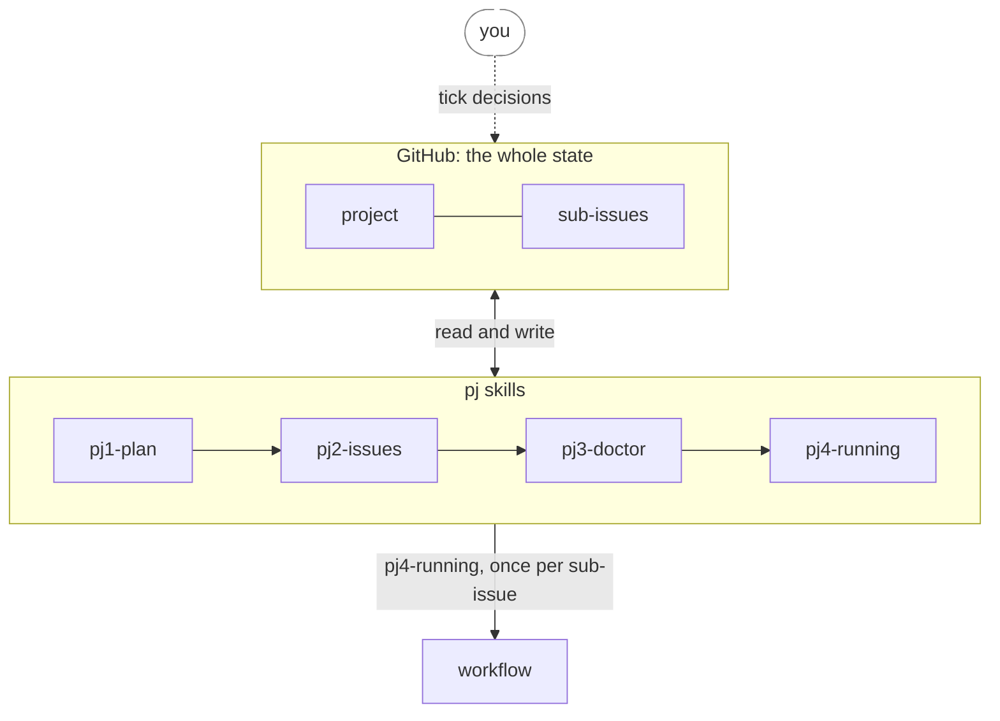
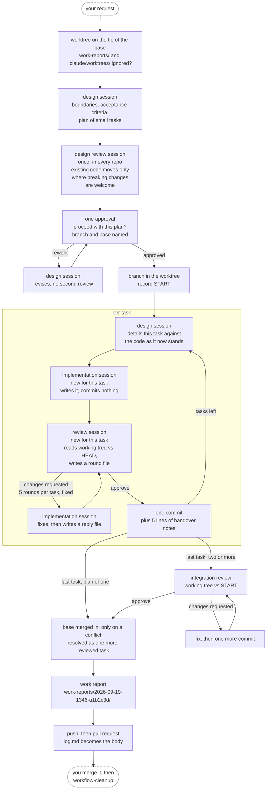
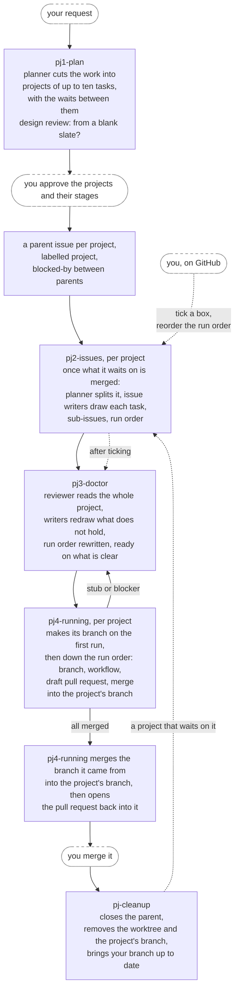
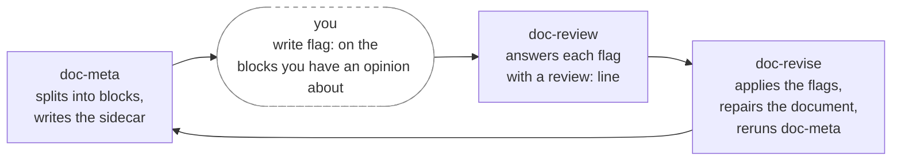

# annetaan

Claude Code skills from Annetaan Inc., packaged as one plugin.

```
/plugin marketplace add annetaan/claude-plugins
/plugin install annetaan@annetaan
```

Install it once. As skills get added, run `claude plugin marketplace update annetaan` and
`claude plugin update annetaan@annetaan` in a shell to keep up, or turn on auto-update for the `annetaan`
marketplace in `/plugin`.

## How the skills fit together

### workflow is the core

`workflow` runs one implementation for one request: a design, your approval, then each task implemented, reviewed
and committed, and at the end a pull request. Everything in this plugin that writes code goes through it.
While it runs, its state lives in the session and in its work report under `work-reports/` on disk. Nothing reaches
GitHub until the finish step pushes and opens a pull request. It works in a worktree of its own.

### The pj skills drive workflow

The pj skills are for work too large for one pull request, and they write no code themselves. `pj1-plan` cuts the
work into projects, each a parent issue. A parent is blocked by the parents of the projects it waits on. `pj2-issues`
splits one project into sub-issues once every project it waits on is merged. You tick the decisions on GitHub.
`pj3-doctor` makes the issues ready. `pj4-running` runs `workflow` once per sub-issue, merges each pull request into
the project's branch and closes the issue, and at the end opens the pull request that takes the project's branch
back. The four pass nothing to each other through the conversation. Each one reads the project from GitHub afresh.
`pj-auto` drives the doctor and the runner and stops where you are needed. `pj-cleanup` tidies up once you have merged
a project. `workflow-cleanup` does the same for a workflow run. `pj-roadmap` brings an existing roadmap file into the
format the pj skills read, through a pull request.

Which skill to start with:

- A change that fits one pull request: `/annetaan:workflow`.
- Anything larger, usually one initiative from your roadmap file ([Task, project, initiative](#task-project-initiative)): `/annetaan:pj1-plan`.

The doc skills are a separate family, for writing and revising documents, and do not use either of these. `experience-video` stands alone too. It touches neither GitHub nor your code.

### Task, project, initiative

The pj skills size work at three levels, from fine to coarse.

| Level | What it is | Where it lives |
| --- | --- | --- |
| task | one implement, review and commit unit, which becomes one commit | a sub-issue, which becomes one pull request into the project's branch |
| project | tasks aimed at 7 to 8, 10 at most, on the base branch `pj/<n>`, which reaches the branch it was made from in one pull request | a parent issue labelled `project` |
| initiative | the input of one `pj1-plan` run, which cuts it into one or more projects | an entry in the roadmap file, a `## ` section. On GitHub only as the `Roadmap:` line of one of its projects |

A standalone `workflow` run has tasks too: each item of its plan is one, and the whole run becomes one pull request.

An issue is the GitHub container, not a level: a parent issue holds a project, and a sub-issue holds a task. Stages
and the run order are orders, not levels. A stage groups the projects of one `pj1-plan` run that can run in
parallel, and the run order is the order of the tasks inside one project.

Keep your initiatives in a roadmap file, and put on GitHub only the projects of the initiatives you are working on.

- The file is `roadmap.md` or `ROADMAP.md`, at the root of the repository or under `doc/` or `docs/`, and there is
  exactly one.
- Each initiative is one `## ` section with a unique heading, and the rest is free
  ([format.md](skills/pj1-plan/format.md), The roadmap file).
- The pj skills check the file with a script. When it is not in that shape, `pj1-plan` stops and points to
  `/annetaan:pj-roadmap`, which rewrites it through a pull request.
- When you start an initiative, hand its entry to `/annetaan:pj1-plan`, quoted or by its heading.
- You do not edit the roadmap when the initiative is done. The last task of one of its projects deletes the entry and
  fixes the names in other entries that the initiative renamed or removed, and that reaches your branch in the
  project's pull request.
- A repository with no roadmap file, or a request that is no entry of it, is planned the same way, with nothing
  written to a roadmap.

### GitHub holds the state

In short, from [format.md](skills/pj1-plan/format.md)'s The parts:

| What | On GitHub |
| --- | --- |
| a project | parent issue, label `project` |
| the initiative's roadmap entry | the `Roadmap:` line on one parent |
| split into tasks | `doing` label on the parent |
| a task | a sub-issue |
| your decisions | ticked checkboxes |
| an order between projects | blocked-by between the parents |
| an order between tasks | blocked-by inside one project |
| the run order | the parent's `## Order` |
| can run | `ready` label |
| stopped on | `blocker` label |
| where the work lands | branch `pj/12` |
| one task's change | one pull request |
| what sessions learnt | the parent's handover comment |

Only two pieces of a project's state live outside GitHub: your approval within one run, which the next run asks for
again unless it starts `unattended` (every run of a `pj-auto` drive does, under the drive's one approval), and the
uncommitted work a run leaves in its worktree under `.claude/worktrees/` when it ends without saving it, which the
next run saves to `stopped.diff` and discards, and never uses.
Because of this, a project can stop anywhere and resume in another session or on another machine.

The work report of each task is a record, not state. It stays local and no later run reads it. A stopped task's work is saved there too, as `stopped.diff`, and so is the work a dead run left in the worktree, in a
`<stamp>-discarded` directory. Only its `log.md` reaches GitHub, as the pull request's body.



The pj skills keep nothing between runs. Each one reads the project from GitHub and writes back to it, and you make
your decisions there too.

## Skills

A skill whose `description` matches a request normally starts without being named. The ones here do not. `workflow`
spawns several sessions, adds commits, creates a worktree and pushes a branch on its own. `workflow-cleanup` deletes
branches and removes a worktree. `pj-roadmap` creates a worktree, pushes a branch and opens a pull request. The pj skills create, edit and close
issues and labels on GitHub, and `pj4-running` also creates each project's branch, pushes, opens and merges pull
requests. The doc skills make a file next to your document, rewrite the document itself, and can add one commit of
their own to `.gitignore` after asking. `experience-video` installs npm packages, downloads a browser on its first
run and writes a directory of files. Any of these is enough reason to wait, so each skill here starts only when you
name it or invoke its slash form. One request is the exception: asking to resolve the conflicts of a pull request, in
any words, starts `workflow`, or `pj4-running` for a project's pull request, because the request itself says what to
do.

### workflow

`/annetaan:workflow` ([details](skills/workflow))

Runs one implementation through sessions with different jobs. A design session writes the plan, then details each
task as its turn comes. A design review session pushes the design toward its ideal shape once, before approval, and
checks the behaviour the design keeps from existing code. It moves existing code only where breaking changes are
welcome. An implementation session writes the code for one task. A review
session reads it and writes its findings to a file. Those last two are new for every task. You approve once, near the start, and
the approval message names the branch and the base. The run happens in `.claude/worktrees/wf-<stamp>`.

The review rounds run through Markdown files in the run's work report directory. The review session writes one file
per round, and the implementation session answers each finding in a reply file next to it. Nobody edits a file once
it is written, so the directory reads back as the whole review, in order.



The "per task" block repeats for every task in the plan, and nothing inside it runs in parallel, because there is one
worktree. Everything after the approval runs on its own. A task that passes review becomes one commit, so the
commit list reads back as the plan. A task that does not settle in five rounds comes back to you with the open
points laid out, and its changes stay uncommitted in the run's worktree. When the base moved during the run and the
branch now conflicts with it, the finish step merges the base in and resolves the conflicts as one more reviewed task
before it pushes. A pull request that conflicts later is resolved the same way when you ask for it in plain words,
such as "コンフリクト解消して", with no skill named ([Conflicts](skills/workflow/README.md#conflicts)).

`pj4-running` runs this flow once per task ([Driven from an issue](skills/workflow/README.md#driven-from-an-issue),
[How the skills fit together](#how-the-skills-fit-together)).

Every run leaves a work report behind, inside the repository under `work-reports/` so that you see them. The skill checks that git ignores `.claude/worktrees/` and `work-reports/` before it writes anything, and asks
before adding them to `.git/info/exclude`. That file stays in your clone, so nothing is committed and `.gitignore` is
never edited. `/annetaan:workflow-cleanup` moves the report into your clone's `work-reports/` once the run is over, and deletes the reports that have sat there for 14 days or more.

### pj1-plan, pj2-issues, pj3-doctor, pj4-running

These four skills run an initiative, a piece of work too large for one pull request, as one or more projects on GitHub. A project is
a parent issue labelled `project`, which holds that project's design and its run order, plus one sub-issue per task,
at most ten tasks per project. A task is aimed at thirty files at most, tests included, and fifty are accepted when the code needs them. A project that waits on another is blocked by it, parent to parent, through GitHub's
own blocked-by relationship. Blocked-by between sub-issues stays inside one project. Projects that wait on nothing
between them run in parallel, and `pj1-plan` shows them as stages. The run order is a numbered list in the parent,
`1. #12`, `2. #13`, and GitHub shows each line with the issue's title and whether it is closed, so the list doubles as
the progress. You may reorder it by hand.

You decide by ticking boxes on GitHub. Every question a task raises is a decision in its sub-issue, a few options as
checkboxes with one recommended, and each option says what it changes. No skill asks you a task's decision in the
conversation. While a decision is open, the sub-issue's title ends with how many are settled, such as `(1/3)`, and the
count goes away once every one is. Ticking a box leaves the title as it is until the next `pj3-doctor` run.

Each project's work lands on a branch of its own, `pj/` and the parent's number. `pj4-running` creates it on the
project's first run, from a branch you pick when the projects are filed, the default branch unless you name another.
A project that waits on another is split into tasks, and gets its branch, only after the other one is merged into
that branch. Every
sub-issue's pull request merges into its project's branch. Once every sub-issue is closed, `pj4-running` merges the
branch it came from into it, with `workflow` resolving any conflict under review, then opens the pull request that
takes that branch back into the branch it came from, and merging it is left to you. After that the parent is closed, by `pj-cleanup`, the next `pj4-running` run or you, and
a closed parent means its project is merged. [How the skills fit together](#how-the-skills-fit-together) says where
the state lives. [format.md](skills/pj1-plan/format.md) describes the issues and their bodies,
[state.md](skills/pj1-plan/state.md) how the state of a project is read, and
[between-skills.md](skills/pj1-plan/between-skills.md) how the four skills work together.

`/annetaan:pj1-plan` ([details](skills/pj1-plan/SKILL.md)) starts with a planner session. Its input is usually one initiative from your roadmap file, by heading or quoted. It draws the whole in
broad strokes and cuts it into projects of about 7 to 8 tasks, at most ten, with the dependencies between them. It cuts only where the work does not fit one project or where the
projects can run in parallel, so a chain of work that can only go one way stays one project unless it is too large. A design review
session reads each project's design once and asks whether a blank slate would give the same design, including
behaviour carried over from existing code. It moves existing code only where breaking changes are welcome, decided
the same way as for `workflow`. The planner takes in what it agrees with, and the rest reaches you as plan-level
questions before approval. You
answer the plan-level questions and see the projects in stages, with the reason for each wait. You approve them and
pick the branch the projects start from. Nothing reaches GitHub before that. Then one parent issue per project is
filed, blocked by the parents it waits on. When the request is a roadmap entry, one project of the last stage, the largest, carries a `Roadmap:` line naming the file and the entry. No sub-issue and no branch is created yet, and no issue is `ready` yet.

`/annetaan:pj2-issues` ([details](skills/pj2-issues/SKILL.md)) takes the project to split from a number given, or the only one it could split, and otherwise asks. It offers the
projects with no sub-issue yet whose waited-on projects are all merged, and recommends the lowest-numbered one. A planner
session splits the project against the code as it stands after those merges, and you answer the split-level
questions. You approve the split, any change to the parent shown as a diff, and any change to its blocked-by. Then
one issue writer per task, in parallel, draws its task against the code and picks out what you have to decide. The
design is written so that it holds whichever box you tick. A writer that finds a consequence of the parent's design
returns it to the planner instead of patching its own task, and so does the same workaround appearing in two or more
drafts. The planner redraws the parent, and you approve the split again. The sub-issues, their blocked-by inside the project, the
run order and the titles are filed, and the parent gets the `doing` label. A project that waits on one not merged yet is refused. When a project it waits
on was closed without a merge, it asks whether to drop that wait. When the planner finds that the project needs
another project that is not merged yet, `pj2-issues` asks whether to add that wait. On yes, it adds the blocked-by
between the two parents and stops without filing anything else. For the project carrying the `Roadmap:` line, the split
ends with one more task, blocked by every other, that removes the entry from the roadmap.

`/annetaan:pj3-doctor` ([details](skills/pj3-doctor/SKILL.md)) takes the project from a number given or the only
project that has sub-issues, and otherwise asks which project to work on. A
reviewer session reads the whole project against the boxes you ticked, the code, and each issue in it: a ticked
option the design does not hold, two issues that disagree on a name, a missing blocked-by, a stub, a blocker, a parent that keeps behaviour whose
assumption the project changed. One
issue writer per issue with a finding redraws it, and a question only you can answer becomes a new decision to tick.
The reviewer reads the rewrites once more. A finding it then tags as a pure text fix, one string for another, goes
back to the writer and is checked against the reviewer's strings with no third review, so the issue can still be
labelled `ready` in the same run. The doctor asks you only about a split, two boxes ticked in one decision, and the
changes before it writes them. Then it rewrites the run order and labels `ready` every issue that came out
clear. While the project's branch does not exist yet, it may also change which projects this one waits on, after
you approve. It keeps the roadmap task blocked by every issue filed later, so it stays last. Run it once after `pj2-issues`, tick the boxes it lists, and run it again.

`/annetaan:pj4-running` ([details](skills/pj4-running/SKILL.md)) takes the project the same way. On the
project's first run it creates the project's branch. When a project it waits on is not merged yet, it lists those
projects and stops instead. It closes the parent of any project it finds merged, its own or one it waits on. Then it
checks that you can merge your own pull request into the project's branch without an approving review. It walks the
run order from the top and takes issues until the first one that is not workable, then checks every issue it took.
Any issue that needs design again sends the run back to `pj3-doctor` before anything starts. After you approve the
order, each task goes through the same steps in turn, in a git worktree of the project's own under
`.claude/worktrees/`, so you can keep working in your clone while the run goes on. Before it starts work it assigns
you to the parent, and it stops when someone else is assigned. The assignment stays for the life of the project, and a
person removes it to hand the project over. Each task gets a branch.
[workflow](skills/workflow/README.md#driven-from-an-issue) runs it as one task, with review rounds. A draft pull
request follows, with the work report as its body. Then the merge into the project's branch, by squash where the
repository allows it. pj4-running then closes the issue itself, because GitHub closes nothing on a merge into a
branch other than the default. Once every sub-issue is closed, it opens the pull request from the project's branch
into the branch it came from, for you to merge. Work nobody planned becomes a new issue. Work that has to
come first stops the run and gets the `blocker` label. The next run picks up where this one stopped. When it finds
a project merged and closes its parent, it names the projects that can now be split, as `/annetaan:pj2-issues` with
their numbers. It does not take the roadmap task while an open sub-issue is not among its blockers, and sends the project
back to `pj3-doctor`.

```
/annetaan:pj1-plan add CSV export to every report screen
/annetaan:pj2-issues
/annetaan:pj3-doctor
/annetaan:pj3-doctor
/annetaan:pj4-running
```

Tick the open decisions on GitHub between the two `pj3-doctor` runs. An issue number passed after `pj2-issues`, the
doctor or the runner picks its project, and with one candidate they ask nothing. Each later project starts
again from `/annetaan:pj2-issues` once the projects it waits on are merged.



After you merge a project's pull request, `/annetaan:pj-cleanup` tidies up.

What they need:

- `gh` 2.94.0 or later, logged in.
- Issues turned on in the repository.
- The commands run from a clone of the repository.
- For `pj4-running`: write access and a project branch that accepts a merge with no approving review. Your own
  working tree may be dirty, because the run works in a worktree of its own.

The `ready`, `blocker`, `project` and `doing` labels are created when missing, and a label that already exists is reused as
it is.

`pj4-running` asks one more question before its first task. When git does not ignore `.claude/worktrees/`
or `work-reports/`, it asks to add them to `.git/info/exclude`. That file stays in your clone, so nothing is
committed, and `.gitignore` is never edited. When an earlier run ended without saving its work in the worktree, for
example a process that was killed, it does not ask: it saves that work to `work-reports/<stamp>-discarded/stopped.diff`
in the worktree and discards it. The run then redoes that work. Run one session per project, because a
second session's work in the worktree would be taken for a dead run's.

### pj-auto

`/annetaan:pj-auto` ([details](skills/pj-auto/SKILL.md)) drives `pj3-doctor` and `pj4-running` on one project until the
project needs you. It takes the project the same way they do. A script, `auto.sh`, asks `project.sh --next` what comes
next and starts that step as a fresh `claude -p` run in unattended mode, one process per step. It never reads a run's
report to decide, only the project on GitHub.

It asks one approval question per drive, and only when a step would run (the question which project comes before it, when
the project is not given or the only candidate): a summary of the project, what the steps do and which of the
permissions they need your settings lack, then start or not. That approval covers the whole drive, and the runs ask nothing. Each run starts in Claude Code's acceptEdits mode,
so it edits and writes files inside your clone, the project's worktree and a directory of its own without asking. The merges
into the project's branch happen. The project's own pull request is never merged.

The drive stops when the project needs you (a split, a wait, a decision to tick, the project's pull request to merge),
when it is done, when a run ends needing you, when a run changes nothing, when `pj3-doctor` has run twice on the same
issue, when a run fails, or when you say stop in the conversation. It then names what you do next. Every step writes a
line in `drive.jsonl` in the log directory it prints when it starts, with the time and the files it writes, and another
when it ends, so the `tail -f` command it shows tells what is running and since when. Each step is a
whole session, so a long project costs many.

```
/annetaan:pj-auto
```

What it needs:

- the `claude` CLI on the PATH
- the rules every drive needs, because the runs cannot ask: `Bash(gh:*)`, `Bash(git:*)`, the two script rules, and a
  `Read` rule for the plugin's skills directory. pj-auto shows them with the real paths before it asks, because the
  plugin's directory differs per machine. Edits need no rule, because the runs start in acceptEdits mode.
- the repository's own commands, such as the install, the tests and the type checks. pj-auto finds them in `CLAUDE.md`,
  `AGENTS.md`, the package files, CI and the project's handover notes, and names any your settings lack, or block,
  before it asks. Add them to your settings.
- no sub-issue that changes files under `.claude/` can run unattended, because Claude Code asks before writing there
  whatever your rules say. pj-auto names such issues. The drive stops at one, and `/annetaan:pj4-running` run by hand
  does it.

### pj-cleanup

`/annetaan:pj-cleanup` ([details](skills/pj-cleanup/SKILL.md)) cleans up after you merge a project's pull request.
Without a number, it takes the merged project whose worktree is in your clone, and asks when there are several. It
shows what it will do and asks once. Then it closes the parent when it is still open, moves the work reports out of
the project's worktree into `work-reports/` in your clone, removes the worktree, deletes the project's branch on
origin and locally, fast-forwards your local copy of the branch the project merged into, usually `main`, and deletes the work reports in `work-reports/` that have been there for 14 days or more.

It never switches your branch, stashes or resets. When the branch is checked out in your clone, it moves with
`git merge --ff-only`, which refuses rather than overwrite a local change. A local branch with commits origin does not
have is left alone and named in the report, and so is a local project branch with commits nowhere on origin. A
worktree with uncommitted work is removed only when you choose to discard that work. It names the projects that can
be split now that this one is merged.

```
/annetaan:pj-cleanup 12
```

### pj-roadmap

`/annetaan:pj-roadmap` ([details](skills/pj-roadmap/SKILL.md)) brings your roadmap file into the format the pj skills
read. It checks the file on the branch you pick. It does nothing when the file is in the format and, where it could be
read two ways (`###` items under a `## `, or initiatives that are not `## ` sections), you confirm that each `## ` is
an initiative. When the file is not in the format, or you ask for a regroup, it works in a worktree of its own, draws the rewrite so that each initiative is one `## ` section with a unique heading, and shows
where every piece came from. It asks once. Then it commits the rewritten file on a new branch, pushes it and opens a
pull request into the branch you picked. `/annetaan:workflow-cleanup` removes the worktree and the branch after you
merge it.

It changes the structure and keeps every sentence. It never merges, never touches your working tree and never updates a
pull request that is already open.

```
/annetaan:pj-roadmap
```

### workflow-cleanup

`/annetaan:workflow-cleanup` ([details](skills/workflow-cleanup/SKILL.md)) cleans up after a workflow run or a `pj-roadmap` run. Without a
number, it lists the `wf-*` worktrees whose pull request is merged or closed, and those that have none, which is a run that
stopped or one still going in another session. It takes the only candidate, or asks which. It shows what it will do and asks once. Then it moves the work
reports into `work-reports/` in your clone, removes the worktree, deletes the branch locally and on origin,
fast-forwards your local base after a merge, and deletes the work reports in `work-reports/` that have been there for
14 days or more.

It never switches your branch, stashes or resets. Work that nothing else holds is removed only when you choose to
discard it. That means uncommitted changes, commits that are on no other branch on origin, and the branch of a closed
pull request. An open pull request is never touched.

```
/annetaan:workflow-cleanup 57
```

### doc-write

`/annetaan:doc-write <path>` ([details](skills/doc-write/SKILL.md))

Writes a document, or rewrites the one at the path, in one of four styles:

| Style | For | How it is read |
| --- | --- | --- |
| `conclusion-first` | a README, a design document, a pull request, a report | the top first, then only as deep as needed |
| `story` | a technical article, a blog post, a talk | start to end, following the thread |
| `procedure` | a tutorial, setup instructions, a runbook | one step at a time, while doing it |
| `reference` | an API description, a list of settings, a format | one entry, looked up |

The rules change with the style. A `conclusion-first` document may repeat its summary in the detail below it, and a
`story` may use sentences that carry the thread from one part to the next. Some rules hold in every style: plain
words instead of coined terms and abbreviations, a term explained no later than the sentence after it first
appears, and a count the document gives matching what follows. [`styles.md`](skills/doc-meta/styles.md) holds all
of it.

`doc-meta` records the style in the sidecar, and `doc-review` and `doc-revise` judge the document by it. Run
`doc-meta` on the result when you want to flag individual sentences.

### doc-meta

`/annetaan:doc-meta <path>` ([details](skills/doc-meta/SKILL.md))

Splits a document into blocks and writes them into a sidecar file next to it, so you can write an opinion onto the
sentences that matter instead of asking a model to guess. A sub-agent reads the document and the sidecar whole, for
the repetition and the broken promises a single flagged sentence cannot catch. Run it again any time: it matches
old text against new, so a flag and a review survive as long as the words they sit on stay put.

The sidecar is written for you, in the language you are talking to Claude in. A document in another language gets a
translation under each sentence, so you can flag an English document while reading it in Japanese or German. The
document itself, and every edit `doc-revise` makes to it, stays in its own language.

`doc-review` and `doc-revise` complete the loop `doc-meta` starts.



### doc-review

`/annetaan:doc-review <path>` ([details](skills/doc-review/SKILL.md))

Reads the flags you wrote onto a `doc-meta` sidecar and answers each one with a `review:` line: what a `[delete]`
would cost, the other half of a duplication for a `[keep]`, a proposed sentence for an `[edit]`, an answer to a
`[question]`. It never touches the document, and it never touches a flag.

### doc-revise

`/annetaan:doc-revise <path>` ([details](skills/doc-revise/SKILL.md))

Applies the flags you wrote, with `doc-review`'s answers as advice: deletes what you flagged, edits what you asked
to edit, and holds `[keep]` and `[question]` blocks to their exact words while it rewrites the paragraphs around
them. It then checks the whole document for what the edit could have broken elsewhere, and reruns `doc-meta` so the
sidecar matches again.

### experience-video

`/annetaan:experience-video` ([details](skills/experience-video/SKILL.md))

Makes a video of under one minute about what your service is like to use. It follows one customer through a bad
evening, the first meeting with the service, the moment they say "wow", and the better evening after. The idea is
"sell the experience, not the product", from Carmine Gallo's *The Presentation Secrets of Steve Jobs*. You need no
pictures, no footage and no music to start.

It runs in four steps and asks you twice.

1. **Interview.** A few rounds of numbered questions, each with a recommended answer. They end in a Brief and a list
   of scenes. You approve both.
2. **Story.** The skill writes `story.md`, which holds the Brief and one section per scene. A producer agent adds
   the cuts, the fragments and the music.
3. **Preview.** The producer renders a half-size preview, looks at the key frames of every scene, and fixes
   overflowing text and weak timing. You watch the preview and approve a full render, or ask for changes.
4. **Full render.** `out.mp4` lands next to `story.md`.

`story.md` is the whole video, as text. Edit it, or ask for a change in words. Only the cuts that changed are
rendered again. A picture or a clip you have not supplied shows as a placeholder card with its prompt and the path
to drop a file at. The next render uses the file.

The music is your own track, when you give a file and its BPM, or a track the producer synthesizes from a script
and lands its peak on the peak of the story.

```
/annetaan:experience-video
```

Give the path of an existing `story.md` after it, and the skill skips the interview and starts from rendering.

**What it needs**: node 20 or later, `ffmpeg` and `ffprobe` on the PATH, and the network on the first run, for the
packages and a headless browser. Narration uses the macOS `say` command and works on macOS only. It is tested on
macOS.

The formats are in [`story-format.md`](skills/experience-video/story-format.md),
[`scenes.md`](skills/experience-video/scenes.md) and [`music.md`](skills/experience-video/music.md).

## Agents

These are the sub-agents the skills spawn. Anything under `agents/` becomes callable as `annetaan:<name>`.
The model and the effort are pinned here, and a skill selects one by name alone. When a Fable agent other than the
design review cannot start, the skill spawns it again on opus at the same effort.

| Agent | Model | Effort | Role |
| --- | --- | --- | --- |
| `annetaan:workflow-design` | fable | medium | design. returns the design and the plan |
| `annetaan:workflow-design-review` | fable | medium | design review for `workflow` and `pj1-plan`. once, before approval, in every repository. moves existing code only where breaking changes are welcome |
| `annetaan:workflow-worker` | sonnet | medium | implementation, for every task |
| `annetaan:workflow-reviewer` | opus | medium | review, for every task, and the integration review when the plan has more than one task |
| `annetaan:pj-planner` | fable | medium | planning for `pj1-plan` and `pj2-issues`. the projects, their designs and the waits between them, then one project's split into tasks. answers the design review |
| `annetaan:pj-issue-writer` | opus | medium | one sub-issue, drawn against the code. drafts it for `pj2-issues`, revises it for `pj3-doctor` |
| `annetaan:pj-reviewer` | fable | medium | project review for `pj3-doctor`. reads the whole project against the ticked boxes, the code and each issue |
| `annetaan:experience-video-producer` | fable | medium | production for `experience-video`. fills in the cuts, fragments and music of a story, renders it, and checks its frames |
| `annetaan:doc-meta-overview` | opus | high | overview for `doc-meta`. finds what a per-sentence flag misses |

`pj4-running` has no agents of its own. It runs workflow's.

`pj-auto` has no agents of its own. The runs it starts use theirs. `pj-cleanup`, `pj-roadmap` and `workflow-cleanup` have none either.

The agent definitions are thin. The substance of each role lives in the skill's `roles/*.md`, and an agent reads
that path out of the prompt the main session hands it.

## Adding a skill

Create `skills/<name>/SKILL.md`. Everything under `skills/` is picked up on its own. Raise `version` in
`plugin.json` and users get it on their next update. Without a new `version`, they keep the cached copy.

The slash form is `/annetaan:<directory name>`. The plugin name is prefixed for you, so a directory never needs an
`annetaan-` in front of it.

Agent names share one namespace across every skill in the plugin. Prefix an agent with the skill that owns it
(`workflow-design`, `workflow-worker`) and the second skill will not have to rename anything.

### Pointing at a bundled file

Never write an absolute path like `~/.claude/skills/...` when a skill reads a script or a document it ships with.
Installed as a plugin, the real location is under `~/.claude/plugins/cache/annetaan/annetaan/<version>/...`.

Write `${CLAUDE_SKILL_DIR}` instead. Claude Code replaces it in the body of a SKILL.md with the absolute path of
the skill's directory. Each skill here gives that path a short name near the top (`workflow` calls it `$FLOW`) and
uses the name from there on.

The replacement happens only in SKILL.md. A file the skill hands to a sub-agent, such as `workflow/roles/*.md`, is
read as plain text. It has to work the path out from where it was read, or take it from the prompt.

A file the main session reads on the skill's behalf, such as `workflow/from-issue.md` or `pj4-running/issues.md`, has
no replacement either. Its SKILL.md names it with its full path, and the file uses the short name SKILL.md
gives. A file that uses that name says so in one line at its top.

A skill that reads another skill's file goes through its own directory, as `pj3-doctor` reads
`$DOCTOR/../pj1-plan/format.md`.
