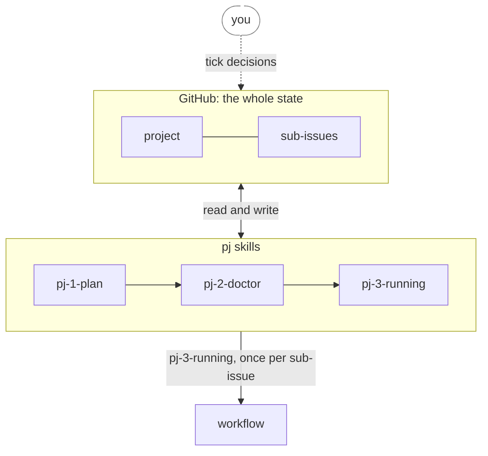
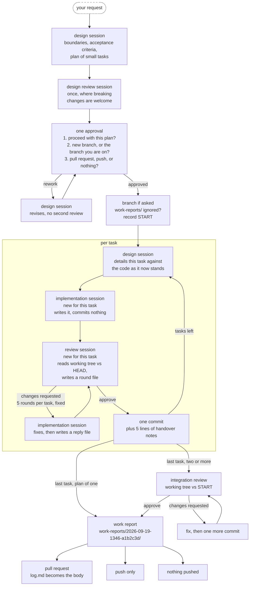
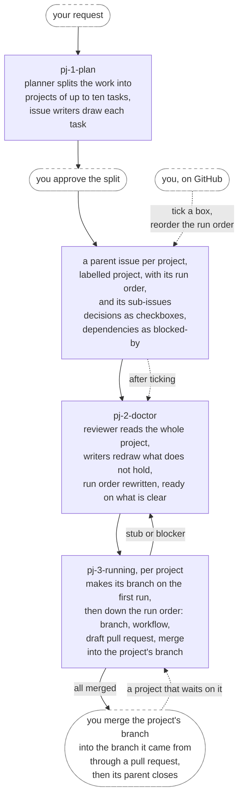
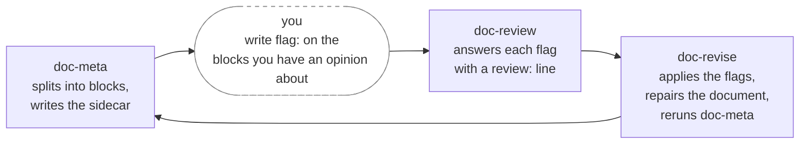

# annetaan

Claude Code skills from Annetaan Inc., packaged as one plugin.

```
/plugin marketplace add annetaan/claude-plugins
/plugin install annetaan@annetaan
```

Install it once. As skills get added, run `claude plugin marketplace update annetaan` and
`claude plugin update annetaan@annetaan` in a shell to keep up, or turn on auto-update for the `annetaan`
marketplace in `/plugin`.

## How the skills fit together

### workflow is the core

`workflow` runs one implementation for one request: a design, your approval, then each task implemented, reviewed
and committed, and at the end an optional pull request. Everything in this plugin that writes code goes through it.
While it runs, its state lives in the session and in its work report under `work-reports/` on disk. Nothing reaches
GitHub until the finish step opens a pull request or pushes.

### The pj skills drive workflow

The pj skills are for work too large for one pull request, and they write no code themselves. `pj-1-plan` splits the
work into a parent issue and its sub-issues. You tick the decisions on GitHub. `pj-2-doctor` makes the issues ready.
`pj-3-running` runs `workflow` once per sub-issue, merges each pull request into the project's branch and closes the
issue. The three pass nothing to each other through the conversation. Each one reads the project from GitHub afresh.

Which skill to start with:

- A change that fits one pull request: `/annetaan:workflow`.
- Anything larger: `/annetaan:pj-1-plan`.

The doc skills are a separate family, for writing and revising documents, and do not use either of these.

### GitHub holds the state

In short, from [format.md](skills/pj-1-plan/format.md)'s The parts:

| What | On GitHub |
| --- | --- |
| a project | parent issue, label `project` |
| a task | a sub-issue |
| your decisions | ticked checkboxes |
| an order between tasks | blocked-by |
| the run order | the parent's `## Order` |
| can run | `ready` label |
| stopped on | `blocker` label |
| where the work lands | branch `pj/12` |
| one task's change | one pull request |
| what sessions learnt | the parent's handover comment |

Only two pieces of a project's state live outside GitHub: your approval within one run, which the next run asks for
again, and the uncommitted work a stopped run leaves in its worktree under `.claude/worktrees/`, which the next run
never uses. Because of this, a project can stop anywhere and resume in another session or on another machine.

The work report of each issue is a record, not state. It stays local and no later run reads it. Only its `log.md`
reaches GitHub, as the pull request's body.



The pj skills keep nothing between runs. Each one reads the project from GitHub and writes back to it, and you make
your decisions there too.

## Skills

A skill whose `description` matches a request normally starts without being named. The ones here do not. `workflow`
spawns several sessions and adds commits on its own. The pj skills create, edit and close
issues and labels on GitHub, and `pj-3-running` also creates each project's branch, pushes, opens and merges pull
requests. The doc skills make a file next to your document, rewrite the document itself, and can add one commit of
their own to `.gitignore` after asking. Any of these is enough reason to wait, so each skill here starts only when you
name it or invoke its slash form.

### workflow

`/annetaan:workflow` ([details](skills/workflow))

Runs one implementation through sessions with different jobs. A design session writes the plan, then details each
task as its turn comes. In a repository that accepts breaking changes, a design review session pushes the design
toward its ideal shape once, before approval. An implementation session writes the code for one task. A review
session reads it and writes its findings to a file. Those last two are new for every task. You approve once, near the start, and
answer two questions about where the commits go and how the run should end.

The review rounds run through Markdown files in the run's work report directory. The review session writes one file
per round, and the implementation session answers each finding in a reply file next to it. Nobody edits a file once
it is written, so the directory reads back as the whole review, in order.



The "per task" block repeats for every task in the plan, and nothing inside it runs in parallel, because there is one
working tree. Everything after the approval runs on its own. A task that passes review becomes one commit, so the
commit list reads back as the plan. A task that does not settle in five rounds comes back to you with the open
points laid out, and its changes stay uncommitted in the working tree.

`pj-3-running` runs this flow once per issue ([Driven from an issue](skills/workflow/README.md#driven-from-an-issue),
[How the skills fit together](#how-the-skills-fit-together)).

Every run leaves a work report behind, inside the repository under `work-reports/` so that you notice them piling
up. The skill checks that git ignores that directory before it writes anything, and asks before touching
`.gitignore`.

### pj-1-plan, pj-2-doctor, pj-3-running

These three skills run a piece of work too large for one pull request as one or more projects on GitHub. A project is a
parent issue labelled `project`, which holds that project's design and its run order, plus one sub-issue per task, at
most ten tasks per project. The dependencies are GitHub's own blocked-by relationships, and one may run from a task
in one project to a task in another. The run order is a numbered list in the parent, `1. #12`, `2. #13`, and GitHub
shows each line with the issue's title and whether it is closed, so the list doubles as the progress. You may reorder
it by hand.

You decide by ticking boxes on GitHub. Every question a task raises is a decision in its sub-issue, a few options as
checkboxes with one recommended, and each option says what it changes. No skill asks you a task's decision in the
conversation.

Each project's work lands on a branch of its own, `pj/` and the parent's number. `pj-3-running` creates it on the
project's first run, from a branch you pick when the projects are filed, the default branch unless you name another.
A project that waits on another gets its branch only after the other one is merged into that branch. Every
sub-issue's pull request merges into its project's branch. Merging that branch back into the branch it came from,
through a pull request, is left to you. After that the parent is closed, by the next `pj-3-running` run or by you, and
a closed parent means its project is merged. [How the skills fit together](#how-the-skills-fit-together) says where
the state lives. [format.md](skills/pj-1-plan/format.md) describes the issues and their bodies,
[state.md](skills/pj-1-plan/state.md) how the state of a project is read, and
[between-skills.md](skills/pj-1-plan/between-skills.md) how the three skills work together.

`/annetaan:pj-1-plan` ([details](skills/pj-1-plan/SKILL.md)) starts with a planner session. It draws the whole in
broad strokes, splits it into tasks, and groups the tasks into projects of up to ten. You answer the plan-level
questions, approve the split and pick the branch the projects start from. Nothing reaches GitHub before that. Then
one issue writer per task, in parallel, draws its task against the code and picks out what you have to decide. The
design is written so that it holds whichever box you tick. The parents, their run order and their sub-issues are
filed. No branch is created yet, and no issue is `ready` yet.

`/annetaan:pj-2-doctor` ([details](skills/pj-2-doctor/SKILL.md)) asks which project to work on, every time. A
reviewer session reads the whole project against the boxes you ticked, the code, and each issue in it: a ticked
option the design does not hold, two issues that disagree on a name, a missing blocked-by, a stub, a blocker. One
issue writer per issue with a finding redraws it, and a question only you can answer becomes a new decision to tick.
The reviewer reads the rewrites once more. A finding it then tags as a pure text fix, one string for another, goes
back to the writer and is checked against the reviewer's strings with no third review, so the issue can still be
labelled `ready` in the same run. The doctor asks you only about a split, two boxes ticked in one decision, and the
changes before it writes them. Then it rewrites the run order and labels `ready` every issue that came out
clear. Run it once after `pj-1-plan`, tick the boxes it lists, and run it again.

`/annetaan:pj-3-running` ([details](skills/pj-3-running/SKILL.md)) asks which project to work on, the same way. On the
project's first run it creates the project's branch. When a project it waits on is not merged yet, it lists those
projects and stops instead. It closes the parent of any project it finds merged, its own or one it waits on. Then it
checks that you can merge your own pull request into the project's branch without an approving review. It walks the
run order from the top and takes issues until the first one that is not workable, then checks every issue it took.
Any issue that needs design again sends the run back to `pj-2-doctor` before anything starts. After you approve the
order, each issue goes through the same steps in turn, in a git worktree of the project's own under
`.claude/worktrees/`, so you can keep working in your clone while the run goes on. It gets a branch.
[workflow](skills/workflow/README.md#driven-from-an-issue) runs it as one task, with review rounds. A draft pull
request follows, with the work report as its body. Then the merge into the project's branch, by squash where the
repository allows it. pj-3-running then closes the issue itself, because GitHub closes nothing on a merge into a
branch other than the default. Work nobody planned becomes a new issue. Work that has to
come first stops the run and gets the `blocker` label. The next run picks up where this one stopped.

```
/annetaan:pj-1-plan add CSV export to every report screen
/annetaan:pj-2-doctor
/annetaan:pj-2-doctor
/annetaan:pj-3-running
```

Tick the open decisions on GitHub between the two `pj-2-doctor` runs. The doctor and the runner always ask which
project, and an issue number passed after either one puts its project first.



What they need:

- `gh` 2.94.0 or later, logged in.
- Issues turned on in the repository.
- The commands run from a clone of the repository.
- For `pj-3-running`: write access and a project branch that accepts a merge with no approving review. Your own
  working tree may be dirty, because the run works in a worktree of its own.

The `ready`, `blocker` and `project` labels are created when missing, and a label that already exists is reused as
it is.

### doc-write

`/annetaan:doc-write <path>` ([details](skills/doc-write/SKILL.md))

Writes a document, or rewrites the one at the path, in one of four styles:

| Style | For | How it is read |
| --- | --- | --- |
| `conclusion-first` | a README, a design document, a pull request, a report | the top first, then only as deep as needed |
| `story` | a technical article, a blog post, a talk | start to end, following the thread |
| `procedure` | a tutorial, setup instructions, a runbook | one step at a time, while doing it |
| `reference` | an API description, a list of settings, a format | one entry, looked up |

The rules change with the style. A `conclusion-first` document may repeat its summary in the detail below it, and a
`story` may use sentences that carry the thread from one part to the next. Some rules hold in every style: plain
words instead of coined terms and abbreviations, a term explained no later than the sentence after it first
appears, and a count the document gives matching what follows. [`styles.md`](skills/doc-meta/styles.md) holds all
of it.

`doc-meta` records the style in the sidecar, and `doc-review` and `doc-revise` judge the document by it. Run
`doc-meta` on the result when you want to flag individual sentences.

### doc-meta

`/annetaan:doc-meta <path>` ([details](skills/doc-meta/SKILL.md))

Splits a document into blocks and writes them into a sidecar file next to it, so you can write an opinion onto the
sentences that matter instead of asking a model to guess. A sub-agent reads the document and the sidecar whole, for
the repetition and the broken promises a single flagged sentence cannot catch. Run it again any time: it matches
old text against new, so a flag and a review survive as long as the words they sit on stay put.

The sidecar is written for you, in the language you are talking to Claude in. A document in another language gets a
translation under each sentence, so you can flag an English document while reading it in Japanese or German. The
document itself, and every edit `doc-revise` makes to it, stays in its own language.

`doc-review` and `doc-revise` complete the loop `doc-meta` starts.



### doc-review

`/annetaan:doc-review <path>` ([details](skills/doc-review/SKILL.md))

Reads the flags you wrote onto a `doc-meta` sidecar and answers each one with a `review:` line: what a `[delete]`
would cost, the other half of a duplication for a `[keep]`, a proposed sentence for an `[edit]`, an answer to a
`[question]`. It never touches the document, and it never touches a flag.

### doc-revise

`/annetaan:doc-revise <path>` ([details](skills/doc-revise/SKILL.md))

Applies the flags you wrote, with `doc-review`'s answers as advice: deletes what you flagged, edits what you asked
to edit, and holds `[keep]` and `[question]` blocks to their exact words while it rewrites the paragraphs around
them. It then checks the whole document for what the edit could have broken elsewhere, and reruns `doc-meta` so the
sidecar matches again.

## Agents

These are the sub-agents the skills spawn. Anything under `agents/` becomes callable as `annetaan:<name>`.
The model and the effort are pinned here, and a skill selects one by name alone.

| Agent | Model | Effort | Role |
| --- | --- | --- | --- |
| `annetaan:workflow-design` | opus | high | design. returns the design and the plan |
| `annetaan:workflow-design-review` | fable | medium | design review. once, before approval, where the repository accepts breaking changes |
| `annetaan:workflow-worker` | opus | medium | implementation, for every task |
| `annetaan:workflow-reviewer` | opus | medium | review, for every task, and the integration review when the plan has more than one task |
| `annetaan:pj-planner` | opus | high | planning for `pj-1-plan`. the projects, their designs, and the split into tasks |
| `annetaan:pj-issue-writer` | opus | high | one sub-issue, drawn against the code. drafts it for `pj-1-plan`, revises it for `pj-2-doctor` |
| `annetaan:pj-reviewer` | opus | high | project review for `pj-2-doctor`. reads the whole project against the ticked boxes, the code and each issue |
| `annetaan:doc-meta-overview` | opus | high | overview for `doc-meta`. finds what a per-sentence flag misses |

`pj-3-running` has no agents of its own. It runs workflow's.

The agent definitions are thin. The substance of each role lives in the skill's `roles/*.md`, and an agent reads
that path out of the prompt the main session hands it.

## Adding a skill

Create `skills/<name>/SKILL.md`. Everything under `skills/` is picked up on its own. Raise `version` in
`plugin.json` and users get it on their next update. Without a new `version`, they keep the cached copy.

The slash form is `/annetaan:<directory name>`. The plugin name is prefixed for you, so a directory never needs an
`annetaan-` in front of it.

Agent names share one namespace across every skill in the plugin. Prefix an agent with the skill that owns it
(`workflow-design`, `workflow-worker`) and the second skill will not have to rename anything.

### Pointing at a bundled file

Never write an absolute path like `~/.claude/skills/...` when a skill reads a script or a document it ships with.
Installed as a plugin, the real location is under `~/.claude/plugins/cache/annetaan/annetaan/<version>/...`.

Write `${CLAUDE_SKILL_DIR}` instead. Claude Code replaces it in the body of a SKILL.md with the absolute path of
the skill's directory. Each skill here gives that path a short name near the top (`workflow` calls it `$FLOW`) and
uses the name from there on.

The replacement happens only in SKILL.md. A file the skill hands to a sub-agent, such as `workflow/roles/*.md`, is
read as plain text. It has to work the path out from where it was read, or take it from the prompt.

A skill that reads another skill's file goes through its own directory, as `pj-2-doctor` reads
`$DOCTOR/../pj-1-plan/format.md`.
